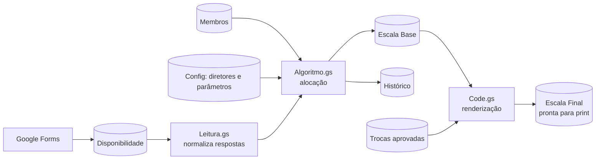

# 📅 Automação de Escala de Plantões

> Sistema de geração semanal de escala construído **100% dentro do Google Sheets** (Apps Script), em uso real na Iniciativa Consultoria (UERJ). Lê a disponibilidade do Google Forms, aplica regras de negócio e entrega a tabela pronta para o grupo, com um clique.


<sub>Exemplo gerado pelo próprio algoritmo com dados fictícios.</sub>

**In English:** a Google Sheets + Apps Script tool that turns Google Forms availability responses into a balanced weekly duty roster, with fixed directors, fixed-day members, split shifts, a swap overlay that never mutates the base schedule, and a Node-based property-test suite for the allocation rules.

---

## O problema

A escala de plantões da empresa júnior era montada **à mão toda semana**: ler dezenas de respostas do Forms, cruzar disponibilidades, evitar repetição, respeitar quem divide plantão e depois formatar o print para o grupo. Era lento, sujeito a erro e difícil de passar adiante para outra gestão.

## A solução

Um menu dentro da própria planilha (`⚙️ Escala`) que:

1. lê as respostas do Forms,
2. gera a alocação semanal respeitando as regras,
3. aplica trocas aprovadas **sem alterar a escala original**,
4. renderiza a tabela final no layout padrão da empresa, pronta para print.

Quem opera é a Gestão de Pessoas, **sem código e sem ferramenta local**.

## Regras de negócio implementadas

| Regra | Comportamento |
|---|---|
| Diretor fixo por dia | Definido na aba `Config`; nunca alterado pelo algoritmo |
| Quem **não divide** plantão | Aparece em **exatamente 1 dia** na semana |
| Quem **divide** plantão | Aparece em 2–3 dias, informando horários em **texto livre** por dia |
| Mesmo nome no mesmo dia | **Proibido**, em qualquer cenário |
| Dia fixo (`Dia_Fixo`) | Membro alocado primeiro no dia combinado, desde que tenha marcado disponível |
| Membro inativo (`Ativo = FALSE`) | Nunca alocado |
| Poucos membros no dia | Aloca quem existe e **segue**; nunca viola limites para "preencher" |
| Trocas | Camada de *overlay*: a Escala Base permanece intacta e a troca é revertível |
| Geração no fim de semana | Detecta sábado/domingo e gera a **próxima** semana |

## Arquitetura



| Arquivo | Responsabilidade |
|---|---|
| `src/Code.gs` | Menu, orquestração, cálculo de datas ISO, renderização da Escala Final e overlay de trocas |
| `src/Config.gs` | Constantes, mapeamento de colunas e leitura de parâmetros |
| `src/Leitura.gs` | Parser das respostas do Forms (por cabeçalho), membros, diretores e histórico |
| `src/Algoritmo.gs` | Alocação: dias fixos → round-robin → completar vagas |
| `src/Setup.gs` | Cria todas as abas, validações e dados de demonstração |
| `tests/run-tests.js` | Testes de propriedades do algoritmo, em Node puro |

## Decisões técnicas

- **Round-robin por rodadas em vez de "dia a dia".** A primeira versão preenchia segunda → sexta em sequência e esgotava os membros cedo, deixando a sexta vazia. Alocar uma vaga por dia a cada rodada distribui de forma equilibrada.
- **Parser orientado a cabeçalho.** As colunas do Forms são localizadas pelo texto da pergunta (com normalização de acentos e caixa), então mudanças na ordem das colunas não quebram a leitura.
- **Texto livre tratado como dado, não como regra.** Quem divide plantão escreve horários como "13h às 15h" ou "13:00 até 16:00". O sistema usa a *presença* da resposta como disponibilidade e preserva o texto original para exibição, sem tentar interpretar o formato.
- **Trocas como overlay.** A `Escala Base` é a fonte da verdade e nunca é reescrita por uma troca; a `Escala Final` é uma *view* derivada. Reverter é mudar um status.
- **Normalização de nomes.** Espaços invisíveis no fim de nomes (comum em Forms) faziam o lookup falhar silenciosamente. Todos os nomes passam por `trim()`.
- **Rotação opcional.** A rotação forçada de dias aumenta a integração, mas conflita com membros que têm rotina fixa. Virou parâmetro (`ROTACAO_ATIVA`) e foi somada ao `Dia_Fixo`.

## Testes

O algoritmo roda fora do Google Sheets (stubs em Node) e é validado por **600 cenários aleatórios e reproduzíveis**, incluindo casos com poucos membros:

```bash
node tests/run-tests.js
# ✅ duplicataNoDia: 0 violações
# ✅ naoDivideEmVariosDias: 0 violações
# ✅ foraDaDisponibilidade: 0 violações
# ✅ inativoAlocado: 0 violações
```

**Os testes encontraram bugs reais** no código que já estava em produção: (1) o passo de dias fixos ignorava membros inativos; (2) um *fallback* para evitar dias vazios ignorava o limite semanal e podia colocar quem não divide em dois dias. Ambos corrigidos, com decisão de projeto documentada no código.

## Como rodar

Veja o passo a passo em [`docs/INSTALACAO.md`](docs/INSTALACAO.md). Resumo:

1. Crie uma planilha no Google Sheets → **Extensões → Apps Script**
2. Cole os arquivos de `src/` (um por arquivo `.gs`)
3. Recarregue a planilha → **⚙️ Escala → 🏗️ Configurar Planilha**
4. A aba `Disponibilidade` vem com **dados fictícios** no formato real do Forms
5. **⚙️ Escala → 📋 Gerar Escala Semanal**

## Resultados

| Métrica | Antes | Depois |
|---|---|---|
| Montagem da escala semanal | Manual: ler cada resposta do Forms, cruzar disponibilidades, alternar os dias e formatar o print | 1 clique (geração automática) |
| Erros de duplicidade / disponibilidade | recorrentes | 0 (validado por testes) |
| Dependência de quem criou a escala | alta | manual de uso para a Gestão de Pessoas |

## Roadmap

- [ ] Registro de eventos/feriados que substituem o plantão do dia
- [ ] Notificação automática da escala (e-mail/WhatsApp)
- [ ] Interpretar horários livres para checar cobertura de carga horária de quem divide
- [ ] Publicação via `clasp` com deploy versionado

## Autor

**Bruno Codeco**: Administração (UERJ), Iniciativa Consultoria.

## Licença

[MIT](LICENSE)
